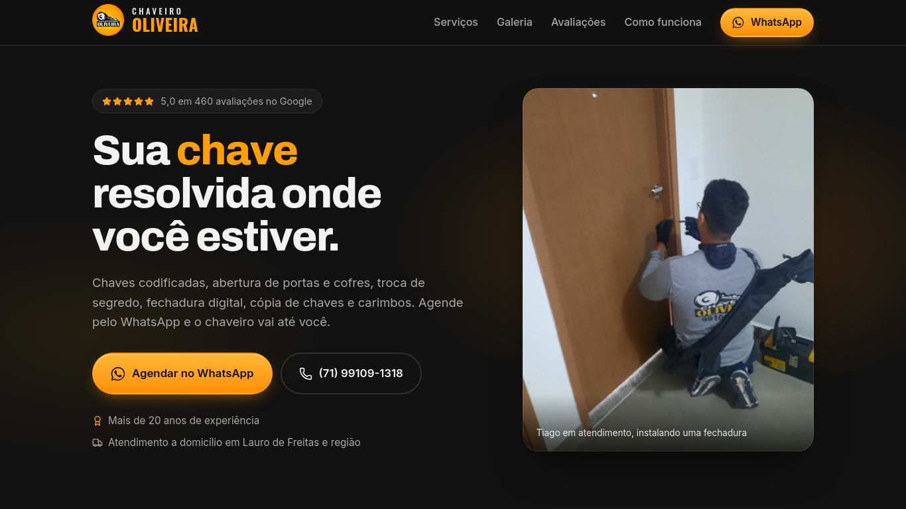
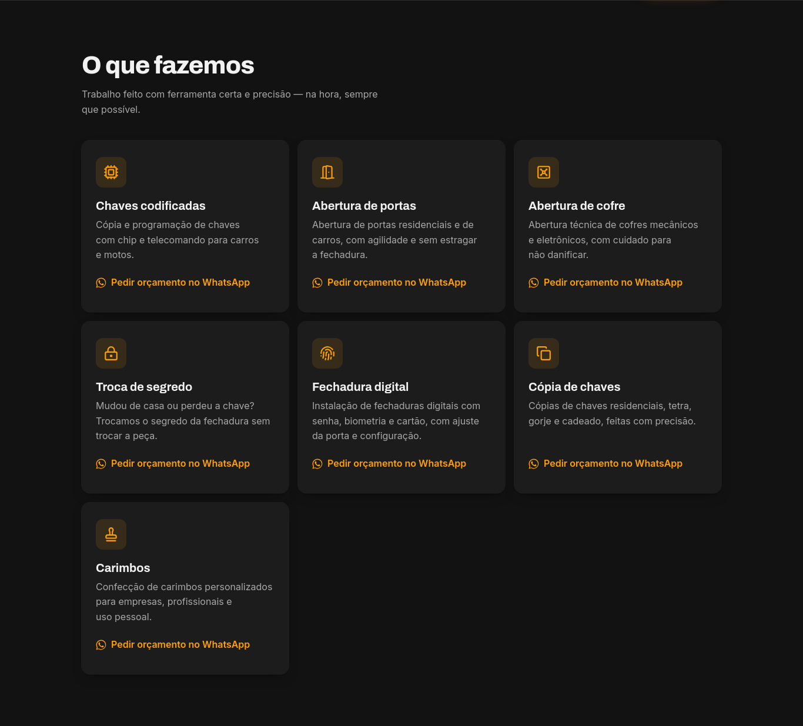
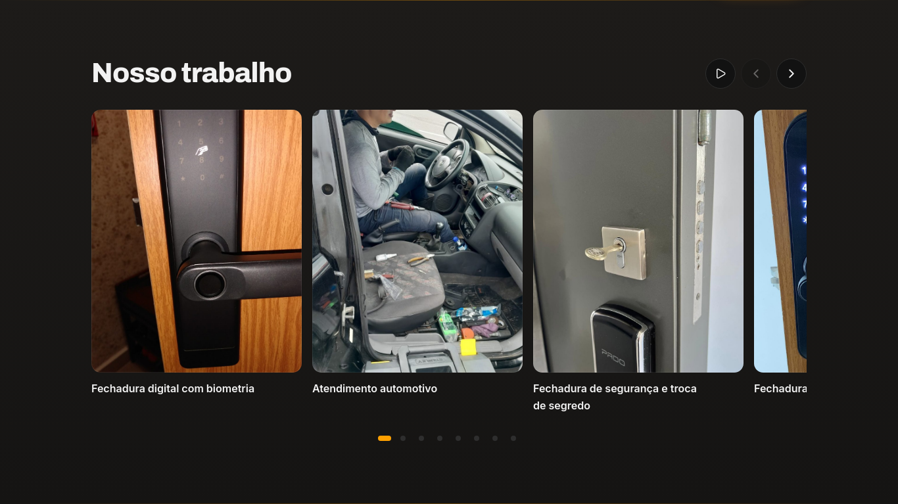
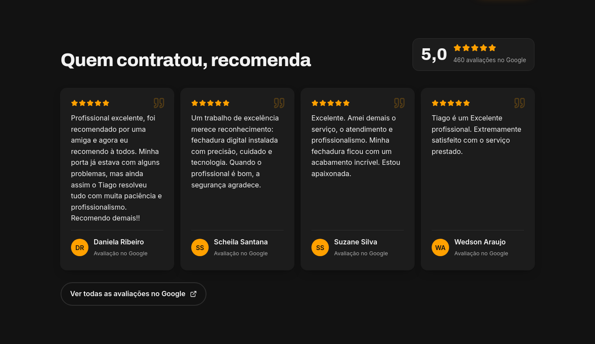
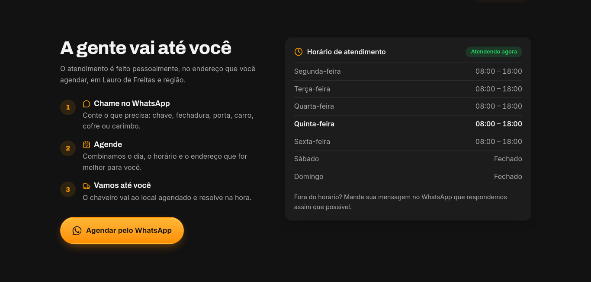

<div align="center" id="top">
  

  &#xa0;

  <a href="https://chaveiro-oliveira.vercel.app/">Demo</a>
</div>

<h1 align="center">Chaveiro Oliveira - Site</h1>

<p align="center">
  

  

  

  

  

  

  
</p>


<hr>

<p align="center">
  <a href="#-sobre">Sobre</a> &#xa0; | &#xa0;
  <a href="#telas-da-aplicação">Telas</a> &#xa0; | &#xa0;
  <a href="#skateboard-funcionalidades">Funcionalidades</a> &#xa0; | &#xa0;
  <a href="#rocket-tecnologias">Tecnologias</a> &#xa0; | &#xa0;
  <a href="#white_check_mark-requisitos-para-rodar-a-aplicação">Requisitos</a> &#xa0; | &#xa0;
  <a href="#checkered_flag-iniciando">Iniciando</a> &#xa0; | &#xa0;
  <a href="#gear-configurações-adicionais-ao-projeto">Configurações</a> &#xa0; | &#xa0;
  <a href="#memo-licença">Licença</a> &#xa0; | &#xa0;
  <a href="https://github.com/juniorvilas" target="_blank">Autor</a>
</p>

<br>

## 😸 Sobre ##

Site do <a href="https://chaveiro-oliveira.vercel.app/">Chaveiro Oliveira</a>, chaveiro com mais de 20 anos de experiência e nota 5,0 no Google, que atende a domicílio em Lauro de Freitas - BA e região.
A landing page apresenta os serviços, fotos reais do trabalho e depoimentos de clientes, e leva o visitante direto para o WhatsApp para agendar um atendimento. Tem efeitos de rolagem no estilo da Apple, carrossel automático e um cadeado interativo em que o cursor vira uma chave.

## Telas da aplicação

### Tela Home Desktop ##


### Tela Serviços Desktop ##



### Tela Galeria Desktop ##



### Tela Avaliações Desktop ##



### Tela Cadeado Interativo Desktop ##


### Tela Atendimento Desktop ##



### Telas Mobile ##


## :skateboard: Funcionalidades ##

:heavy_check_mark: Agendar atendimento pelo WhatsApp com mensagem pronta para cada serviço\
:heavy_check_mark: Ligar direto pelo telefone do site\
:heavy_check_mark: Galeria com fotos reais, passagem automática e navegação por setas, bolinhas e toque\
:heavy_check_mark: Depoimentos de clientes do Google\
:heavy_check_mark: Horário de atendimento com indicação de "Atendendo agora" no fuso da Bahia\
:heavy_check_mark: Cadeado interativo: o cursor vira uma chave e o cadeado abre ao encostar\
:heavy_check_mark: Efeitos de rolagem no estilo da Apple, que se desfazem ao rolar para cima\
:heavy_check_mark: Layout responsivo do celular ao desktop\
:heavy_check_mark: Acessibilidade: navegação por teclado e respeito a "reduzir movimento"\
:heavy_check_mark: SEO local: dados estruturados de chaveiro, sitemap e imagem de compartilhamento\


## :rocket: Tecnologias ##

Abaixo poderá ter acesso às principais tecnologias usadas neste projeto


- [React 19](https://react.dev/)
- [TypeScript](https://www.typescriptlang.org/)
- [Vite](https://vite.dev/)
- [Tailwindcss v4](https://tailwindcss.com/)
- [lucide-react](https://lucide.dev/)
- [ESLint](https://eslint.org/)
- [Vercel](https://vercel.com/)


## :white_check_mark: Requisitos para rodar a aplicação ##

Antes de iniciar :checkered_flag:, você precisa ter [Git](https://git-scm.com) e [Node](https://nodejs.org/en/) 20 ou superior instalados em seu sistema operacional. Se usar o [nvm](https://github.com/nvm-sh/nvm), basta rodar `nvm use 20`.

## :checkered_flag: Iniciando ##

```bash
# Clone este projeto
$ git clone https://github.com/juniorvilas/chaveiro-oliveira.git

# Acesse
$ cd chaveiro-oliveira

# Instale as dependências
$ npm i

# Execute o projeto (abre em http://localhost:5173)
$ npm run dev

# Gere a versão de produção na pasta dist/
$ npm run build
```

## :gear: Configurações adicionais ao projeto ##

- **Conteúdo:** telefone, WhatsApp, e-mail, horários, serviços, fotos da galeria e depoimentos ficam em `src/data/business.ts`.
- **Fotos da galeria:** ficam em `public/media/` e são listadas em `gallery`, no mesmo arquivo.
- **SEO:** título, descrição e dados estruturados para o Google ficam no `index.html`; o `sitemap.xml` e o `robots.txt`, em `public/`.
- **Estilos:** cores, fontes e breakpoints da marca ficam no `@theme` de `src/index.css`. Botão, card e `cn()` ficam em `src/lib/styles.ts`, e `Section`, `Container`, `SectionTitle` e `Lead` em `src/components/ui.tsx`.
- **Animações:** os efeitos de rolagem (`fx`, `fx-left`, `reveal`…) e o cadeado ficam em `src/index.css`, ligados ao `src/lib/scrollFx.ts`.
- **Logo:** o logo original do cliente fica em `logo/`; no site são usados `public/logo.png`, `public/favicon.ico`, `public/favicon-{48,96,192}.png` e `public/apple-touch-icon.png`.
- **Deploy:** cada push na branch `main` publica automaticamente na Vercel.

## :memo: Licença ##

O código deste projeto está sob licença MIT. Para mais informações acesse [LICENSE](LICENSE.md).
O logo, as fotos e os textos são do Chaveiro Oliveira e não fazem parte da licença.

Feito com :heart: por <a href="https://github.com/juniorvilas" target="_blank">Carlindo Junior</a>

&#xa0;

<a href="#top">Voltar ao topo</a>
